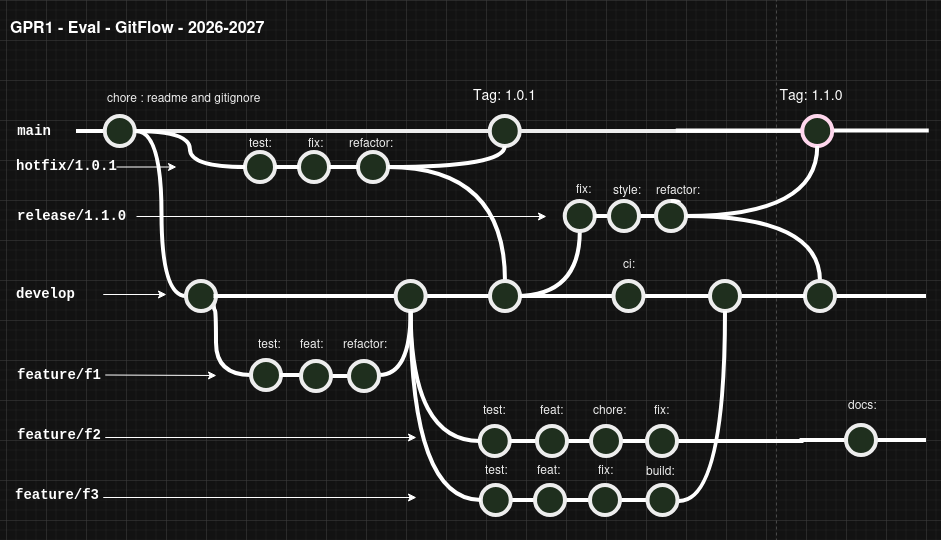

# GPR1 - Evaluation pratique 2026-207 - Gitflow

## Enoncé

Lors de cette épreuve, nous allons valider les compétences suivantes:

* utilisation des commandes git de base (en ligne de commande uniquement)
* application correcte du git-flow (nvie)
* lecture et analyse d'un arbre (tree) produit par git-flow

## Moyens à disposition

| Critère    | Valeur |
| -------- | ------- |
| Accès internet | non |
| Travail collaboratif, IA | non |
| Temps à disposition | 45 min |

Note : durant l'épreuve vous pouvez utiliser tout le matériel à disposition en local sur votre machine (exemple de code, documentation).

Attention : votre terminal ne doit pas vous aider à "pré-saisir" les commandes ni vous proposer des commandes. Si vous n'arrivez pas à désactiver les assistances complétement, optez pour un terminal, hors de votre IDE.

## Pondération et barême

Cette évaluation vaut pour 50% de la note du module.

Le barême est l'habituel [nbPtsObtenus/nbPtsMaximum]/5*1

---

## Préparation de votre environnement

Aucun contenu ne vous est livré. Il s'agit de débuter un tout nouveau projet de versionning.

## Livrables

### Etape 001 - Votre projet

Vous transmettez à votre enseignant, via un message teams personnel, une archive de votre projet.

Nommage : GPR1_<votrePrenom>.zip

!!!Prenez bien le répertoire .git!!!

### Etape 002 - Retour de l'enseignant

Votre enseignant valide la bonne réception du livrable et vous le mentionne en répondant à votre message.

### Etape 003 - Analyse

APRES ET UNIQUEMENT APRES avoir obtenu la validation de la part de l'enseignant, vous pouvez ensuite débuter la phase d'analyse avec soit des commandes git, soit les outils intégrés à votre IDE (sans IA).

Après analyse, vous faites un message bref à votre enseignant via teams auto-évaluant votre projet. Si vous détectez des différences entre votre livrable et le résultat attendu, mettez-les en évidence et expliquez les raisons de cette différence.

## Arbre à obtenir

* Schéma




#### Critères d'évaluation

| Critère    | Valeur | Pondération |
| -------- | ------- | --- |
| Main | Toutes les étapes sont présentes | 3pts |
| Hotfix | Toutes les étapes sont présentes | 3pts |
| Release| Toutes les étapes sont présentes | 3pts |
| Develop| Toutes les étapes sont présentes | 7pts |
| Feature/f2 | Toutes les étapes sont présentes | 5pts |
| Chronologie des branches | Selon le schéma draw io   | 10pts |
| Bonnes pratiques de commits (préfixes) | Selon le schéma draw io   | 3pts |
| Analyse | Auto-évaluation pertinente (validation ou non et pourquoi)   | 10pts |
| Dod | Respect des consignes d'évaluation et des modalités de livraison   | 5pts |

---

## Arbre à obtenir à la fin du travail

```git
git log --graph --oneline --decorate --all
```

```
* 0099f30 (feature/f2) docs:
* 5cb3c42 fix:
* 0974884 chore:
* 9c10806 feat:
* 8662838 test:
| *   c17e573 (HEAD -> develop) Merge tag '1.1.0' into develop
| |\  
| | *   f7f6da1 (tag: 1.1.0, main) Merge branch 'release/1.1.0'
| | |\  
| | | * f8c9af0 refactor:
| | | * c6969fb style:
| | | * c575b5c fix:
| * | |   d20143b Merge branch 'feature/f3' into develop
| |\ \ \  
| | * | | 21a97fa build:
| | * | | c3e46a7 fix:
| | * | | 247499b feat:
| | * | | ca0abab test:
| |/ / /  
|/| | |   
| * | | 78f3a44 ci:
| | |/  
| |/|   
| * | 65450df Merge tag '1.0.1' into develop
|/| | 
| |/  
| *   2c0f973 (tag: 1.0.1) Merge branch 'hotfix/1.0.1'
| |\  
| | * bf36146 refactor:
| | * 83ea04c fix:
| | * 5249a9d test:
| |/  
* |   3f87f62 Merge branch 'feature/f1' into develop
|\ \  
| |/  
|/|   
| * dc95d3f refactor:
| * 92faa16 feat:
| * fd01c01 test:
|/  
* 7dadb72 chore:
```
